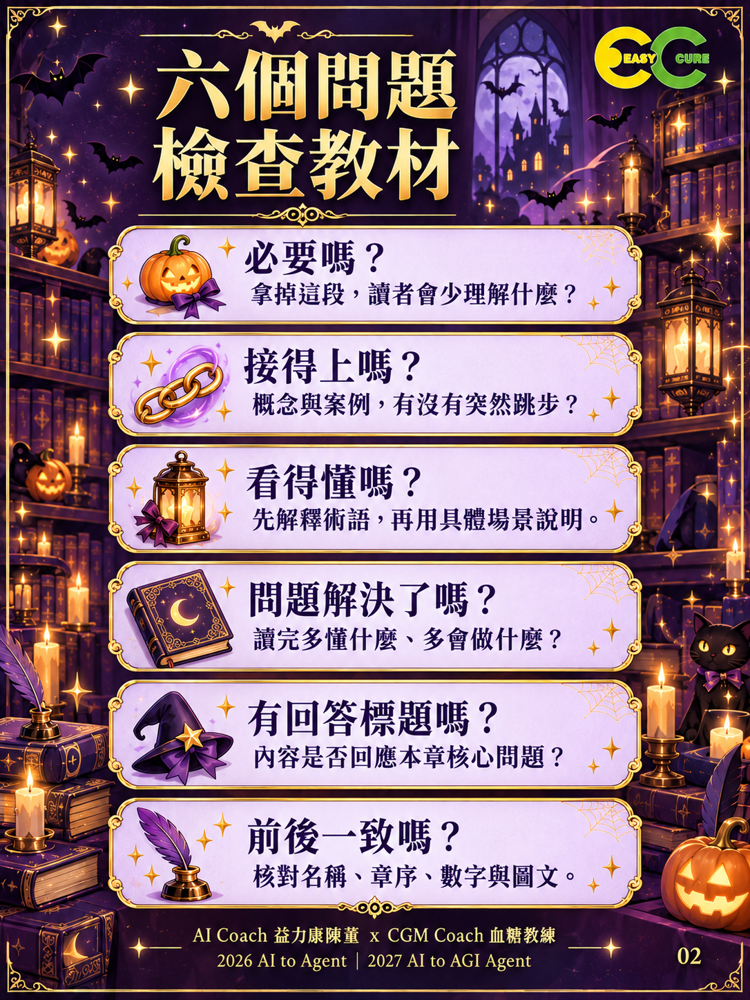
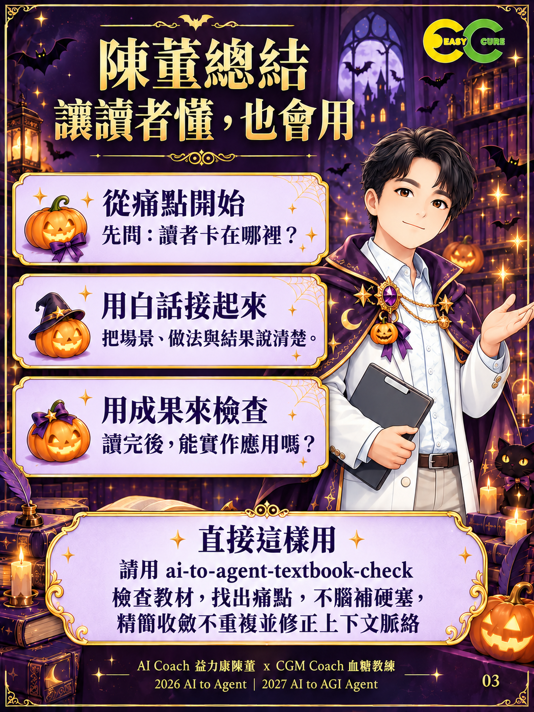

# ai-to-agent-textbook-check｜教材寫作與編輯檢查

從新手小白痛點出發，用最少必要文字，讓讀者更清楚。

適用教材、書稿、課程簡報的撰寫、檢查與改寫。解決術語突現、案例跳接、重複硬塞及前後不一致；保留作者觀點，先判斷問題再決定修改幅度。

## 快速開始

將 `skills/ai-to-agent-textbook-check/` 完整資料夾交給支援 SKILL.md 的工具，依該工具的技能載入方式使用；不支援技能的對話工具，可直接提供 SKILL.md 與需要的範本作為工作指示。本次未進行跨平台安裝測試。

提供待檢查教材、讀者背景與章節目標；跨章檢查時補上相關前後章及總綱。

> 請用 ai-to-agent-textbook-check 檢查教材，找出痛點，不腦補硬塞，精簡收斂不重複並修正上下文脈絡。

只要求檢查時交報告；明確要求改寫時直接交修訂稿並自查。

## 六個檢查問題

| 問題 | 檢查重點 |
|---|---|
| 必要嗎？ | 刪去後是否損失必要理解 |
| 接得上嗎？ | 概念、案例與步驟是否連貫 |
| 看得懂嗎？ | 術語先說明，做法具體 |
| 問題解決了嗎？ | 原理能判斷，實作能應用 |
| 有回答標題嗎？ | 回應本章核心問題 |
| 前後一致嗎？ | 名稱、章序、數字與圖文一致 |

## 輸入、輸出與驗收

輸入是教材、讀者起點、目標及可用來源。輸出包含問題位置、證據、讀者卡點、修改建議；授權改寫時附修訂稿及影響範圍。驗收看是否保留必要資訊、未補造事實、解決理解斷點。不能以字數最少取代說明完整。

不適用於取代專業領域查證、保證學習成效，或在未讀全文時宣稱全書一致。總綱是編輯依據，事實仍需來源驗證。

## 示例與資源

- [改稿示例](skills/ai-to-agent-textbook-check/references/revision-examples.md)
- [總綱範本](skills/ai-to-agent-textbook-check/assets/book-outline.md)
- [改稿紀錄](skills/ai-to-agent-textbook-check/assets/revision-log.md)
- [網誌介紹](docs/blog.md)
- [驗收紀錄](docs/validation.md)
- [發布說明](docs/release-notes.md)

## 三張技能圖卡

## 版本與後續

發布包版本 0.1.0，2026-10-26。狀態：已發布為公開 Repo，tag v0.1.0；尚未建立 GitHub Release。後續依真實使用累積改稿案例，避免把個案變成僵硬規則。

## 授權與作者

技能與原創文字沿用 CC BY-NC 4.0，詳見 [LICENSE](LICENSE)。公司商標與人物肖像不因文字授權而授予獨立使用權；圖片來源及範圍見 [素材說明](assets/SOURCES.md)。

AI Coach 益力康陳董 x CGM Coach 血糖教練 | 2026 AI to Agent｜2027 AI to AGI Agent
